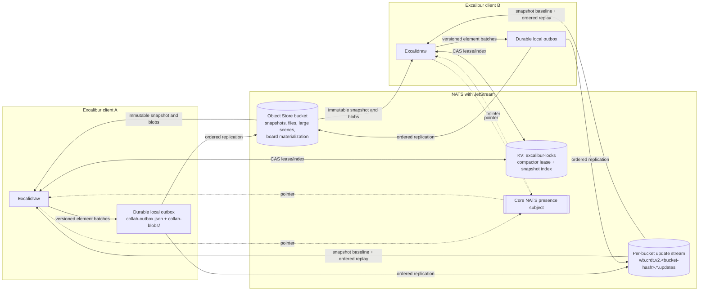

# NATS collaboration infrastructure

Excalibur uses NATS directly for shared remote boards. There is no Excalibur
collaboration server between the desktop applications and NATS. JetStream
provides the durable update log, snapshots, blobs, and coordination; Core NATS
is reserved for ephemeral pointer presence and live scene previews.

Local filesystem boards do not use this protocol. They continue to persist as
ordinary `.excalidraw` JSON files.

## Architecture



## Durable state

Recovering a collaborative board requires two pieces of durable state:

1. the latest activated immutable snapshot at stream sequence `S`; and
2. retained update messages for that document after `S`.

The snapshot is a materialized Excalidraw scene, not an authority that replaces
the update log. It includes deleted elements so Excalidraw tombstones and
version metadata survive compaction. A client applies the snapshot first and
then reconciles each retained update in stream order.

The visible `<board>.excalidraw` Object Store object is also refreshed by the
snapshot leader. It supports board browsing, export, thumbnails, and disaster
recovery, but collaboration recovery uses the indexed immutable snapshot plus
the retained update log.

## NATS resources and names

Each remote board has a stable 128-bit hexadecimal document ID. A hidden
Object Store sidecar maps the user-visible board filename to this ID, allowing a
board to be renamed without changing its collaboration history.

For an Object Store bucket named `B`, Excalibur derives a 16-hex-character token
from SHA-256(`B`) and uses these resources:

| Resource | Name or subject | Purpose |
| --- | --- | --- |
| JetStream stream | `EXCALIBUR_CRDT_<BUCKET_TOKEN>` | Retains durable updates for every document in the bucket |
| Update subject | `wb.crdt.v2.<bucket-token>.<document-id>.updates` | Versioned scene batches and large-scene references |
| Presence subject | `wb.crdt.v2.<bucket-token>.<document-id>.presence` | Ephemeral pointer/laser positions and live element previews over Core NATS |
| Object Store board | `<board>.excalidraw` | Compatibility materialization for browsing and export |
| Document sidecar | `.crdt-document.<board-hash>` | Stable document identity |
| Immutable snapshot | `.crdt.<document-id>.snapshot.<sequence>.<content-hash>` | Tombstone-preserving replay baseline |
| Immutable blob | `.crdt.<document-id>.file.<blob-hash>` | Images and oversized scene messages |
| Deletion marker | `.crdt.<document-id>.deleted` | Prevents a stale compactor from recreating a deleted board |
| JetStream KV bucket | `excalibur-locks` | In-memory snapshot lease and CAS-protected snapshot index |
| Object Store bucket | `excalibur-library` | Shape library shared by every board on the server (hidden from the bucket list) |

Durable resources — the per-bucket update streams, board Object Stores, and the
shared library bucket — are created with three replicas. JetStream does not
expose the cluster size to clients, so creation asks for three and falls back to
two (then one) only when the cluster rejects the placement; a non-clustered
server always uses one. Existing streams created by older builds are upgraded in
place the next time they are opened.

The `excalibur-locks` bucket is deliberately different: it uses memory storage
and a single replica because its leases and snapshot index are coordination
state, not board data. A restart drops the leases (clients simply elect a new
compactor) and the snapshot index, which rebuilds by scanning the immutable
snapshot objects when first read.

### Shared library

The Excalidraw shape library is per server, not per bucket. Clients keep it as
one `library.excalidrawlib` object in `excalibur-library` and watch that bucket,
so a change made in one board appears live in every other open client on the
same server. A client does not echo its own writes (matched by object digest).
Concurrent edits are last-writer-wins on the whole library. The first time a
bucket is opened and no shared library exists, its legacy per-bucket
`library.excalidrawlib` is adopted as the shared library. Local boards keep a
`library.excalidrawlib` file in their folder.

The library mirror runs on a durable JetStream consumer named
`library-watch-<run>`, created on the library stream the first time a client
watches it and reused for the rest of that app run. The run token keeps the
consumer per instance rather than per server: every client needs every library
update, so a consumer shared between clients would load-balance the updates
instead of fanning them out. A 30 minute inactive threshold reclaims the
consumer after the app quits. Mirroring used to run on an Object Store
`Watch()`, whose ordered consumer the client rebuilds after every reconnect,
which left one new consumer instance per reconnect on the stream.

Collaboration update consumers are deliberately different. Each canvas join
creates one ephemeral consumer that starts at the snapshot sequence + 1 and is
deleted when the canvas closes, because a join needs the replay window the
renderer asks for rather than a position remembered on the server. That bounds
the consumer count to one per open canvas instead of one per reconnect.

The update stream uses file storage with no age or byte limit. Updates are
removed only by snapshot-aware compaction. NATS message IDs deduplicate retries
inside JetStream's deduplication window; Excalidraw reconciliation remains
idempotent if an older update is redelivered later.

## Local edit and offline flow

Excalidraw renders edits immediately. Collaboration publication is bounded to
avoid sending pointer-frame updates and normally includes only elements whose
`version`/`versionNonce` changed. Elements already observed in the durable log
from another client are not echoed back by the next local delta. Each durable
message has a stable message ID.
While an element is being dragged, resized, rotated, or drawn, durable
checkpoints are reduced to roughly one per second and the gap is filled with
ephemeral `scene-live` previews. Pointer-up sends one final preview and an
immediate durable delta, so the committed state still uses the normal outbox
path.

Before a collaboration API reports local success, the native backend appends
the update to `collab-outbox.json` and fsyncs it. The outbox is an append-only
JSONL journal with periodic atomic compaction. Images and oversized scene
messages are first stored as files under `collab-blobs/` and represented as
ordered blob entries in the same outbox.

The background replicator:

1. sorts entries by their durable local order;
2. preserves strict order within each source/bucket/document;
3. uploads a blob before publishing an update that references it;
4. stops that document at the first remote failure; and
5. can replicate up to four independent documents concurrently.

Remote failure therefore does not block drawing, navigation, restart, or quit
once the complete edit has reached the local outbox. The journal is replayed on
the next application start. A bucket cannot be deleted while it has pending
local collaboration entries.

## Update messages and reconciliation

A normal durable update contains changed Excalidraw elements plus optional file
references and versioned shared app state:

```json
{
  "type": "scene",
  "from": "peer-id",
  "messageId": "peer-id:42",
  "elements": ["changed Excalidraw elements"],
  "appState": { "viewBackgroundColor": "#ffffff" },
  "appStateVersion": { "counter": 7, "peerId": "peer-id" },
  "fileVersions": { "image-id": 3 },
  "fileRefs": { "image-id": "immutable-blob-key" }
}
```

If one message would exceed the bounded collaboration payload size, the full
message is stored as an immutable Object Store blob and the stream receives a
small `scene-ref` message instead.

Receivers use Excalidraw's `restoreElements()` and `reconcileElements()` rather
than replacing the complete scene or implementing a second CRDT. Element
versions, nonces, and deletion tombstones determine drawing conflicts. Remote
updates use `CaptureUpdateAction.NEVER`, so they do not enter the local undo
stack.

The shared canvas background is not attached as an unversioned last writer to
every drawing update. It carries a Lamport-style `(counter, peerId)` version;
clients compare the pair lexicographically for deterministic last-writer-wins
behavior. Viewport and pointer state are not durable shared app state.

## Opening, replay, and acknowledgements

Opening a remote board follows a snapshot-plus-log protocol:

1. Load the newest known immutable snapshot, or the ordinary board
   materialization when no snapshot exists.
2. Create an ephemeral JetStream consumer beginning after the snapshot
   sequence. Events that arrive during join are buffered.
3. Recheck the snapshot index to close the snapshot-discovery/compaction race.
4. Record the stream sequence that existed when the consumer was established as
   the join catch-up watermark.
5. Apply the selected snapshot.
6. Apply buffered and live durable events serially in consumer delivery order.
7. Fetch every referenced scene or file before advancing the applied sequence.
8. ACK an event only after it has been validated and reconciled.

Delivery gaps, invalid payloads, unavailable references, or reconciliation
failures trigger a fresh snapshot-based replay. The applied watermark never
advances across a failed event, so a snapshot cannot claim to cover data that
the renderer has not incorporated.

Events authored by the same peer are also reconciled during retained replay.
They may be harmless live echoes, but after reopening they can be newer than the
loaded snapshot and must not be discarded.

## Snapshot leadership and compaction

All clients may publish live updates. Snapshot creation is restricted to one
lease holder per document:

- clients contend for a 30-second lease in the `excalibur-locks` KV bucket;
- the holder renews the lease while the board remains open;
- a crashed or disconnected holder can be replaced after expiry; and
- CAS operations prevent a stale holder from overwriting a newer lease or
  snapshot index.

The leader snapshots only a fully applied contiguous stream sequence. It first
uploads an immutable, undiscoverable candidate, then rechecks the lease, board
identity, and deletion marker. A final lease renewal immediately precedes the
CAS snapshot-index activation. Once indexed, the snapshot object is never
deleted as part of a failed activation path.

Excalibur retains a small immutable snapshot rollback window. After activating a
new snapshot it purges updates only through the *previous* snapshot sequence,
leaving one complete interval for a client that raced snapshot discovery.

## Presence and live previews

Pointer and laser positions are sent over the document's Core NATS presence
subject. They are intentionally ephemeral: they never enter JetStream, Object
Store, snapshots, or the local outbox. A client removes a collaborator after the
presence TTL expires and clears presence state when switching boards.

`pointer` messages carry the tool (`pointer` or `laser`) and the button state;
the laser trail is drawn from the press/release edges, so those are never
coalesced away, and laser positions are sent at a higher rate than cursors.
`view` messages carry the scene rectangle a peer currently sees. They are sent
on scroll/zoom, on join, and as a heartbeat, so an idle peer stays listed and
can be followed. When a user follows a peer from Excalidraw's user list, the
follower fits the peer's last known rectangle into its own viewport and tracks
every later `view` message until the follower scrolls or zooms. A followed view
is not saved as the board's remembered viewport.

`pointer` and `view` messages also carry the sender's cursor color (`#rrggbb`)
and emoji avatar, both a few bytes, so a changed name, color, or avatar shows up
immediately (a settings change publishes a `view` message at once) and idle
peers keep it via the heartbeat. Receivers color the remote cursor, draw the
emoji in a floating circle beside it, and show it in Excalidraw's user list. A
client never draws its own avatar. Peers are untrusted: only a short run of
non-ASCII characters is accepted as an avatar.

A peer with an avatar chooses between showing the avatar and name or the avatar
only (`avatarOnly` in the same messages). Excalidraw cannot put an image in its
canvas name tag, so for such peers `pointer.renderCursor` is turned off and an
overlay draws the whole cursor: the arrow, then either a name tag with the
avatar inside it or just the avatar in a circle. Peers without an avatar keep
Excalidraw's own cursor and tag.

`follow` messages tell the followed peer who is following it. The follower
sends one when it starts or stops following and repeats it with the heartbeat;
the followed peer shows a "Followed by …" badge and drops followers whose
heartbeat has expired, so a follower that leaves without unfollowing disappears
after the presence TTL.

The same subject carries `scene-live` messages: best-effort element previews sent
at most about ten times per second during an active drag. They contain only
elements that already have a durable version, are skipped when a message would
exceed the normal collaboration payload bound, and are never acknowledged,
retried, chunked, or written to the outbox. Receivers apply them with
`CaptureUpdateAction.NEVER` and keep them out of the durable scene baseline, so
snapshots can never capture a live-only position.

If the sender disappears mid-gesture, receivers keep the preview for a short
three-second TTL and then roll those elements back to their last durable
version. A late joiner may briefly miss a preview until the next durable
checkpoint; the worst-case durable crash-loss window is approximately one
second.

## Meaning of the synchronization indicator

The status beside Excalidraw's menu distinguishes local durability from remote
convergence:

| Status | Meaning |
| --- | --- |
| `Unwritten changes` | The latest edit exists only in the renderer |
| `Saving locally…` | The edit is being serialized and appended to the local durable outbox |
| `Saved locally · syncing…` | Local durability is complete; remote blob/update replication or replay is pending |
| `Saving changes · retrying…` | Local or remote work failed and is being retried |
| `Synced` | The document outbox is empty, join catch-up is complete, no apply/publication is pending, and this client's own durable messages have been replayed and reconciled |

`Synced` describes durable update replication and application. Snapshot
materialization and old-log compaction may occur later in the background.

The badge is shown only while the canvas has room for it beside the shape
toolbar. On narrower canvases (and in Excalidraw's small-screen layout) the
status moves to the sidebar as a colored dot on the open board's thumbnail, or
below the logo when the sidebar is collapsed; its label is the dot's tooltip.

## Consistency model

NATS supplies durable ordered transport, not document merge semantics.
Excalibur delegates drawing reconciliation to Excalidraw's element conflict
metadata. Consequently:

- unrelated concurrent element changes normally survive and converge;
- competing edits to one element follow Excalidraw's version/nonce rules;
- deletions remain mergeable because snapshots retain tombstones;
- background-color conflicts use deterministic Lamport-style LWW metadata;
- duplicate delivery is safe; and
- collaborators must connect to the same NATS deployment, Object Store bucket,
  and stable document ID.

This is deliberately not a separately implemented general-purpose CRDT. The
application supplies durable transport, ordered replay, tombstone-preserving
compaction, and app-state conflict metadata while Excalidraw remains responsible
for element-level reconciliation and undo semantics.

## Operational requirements

The configured NATS account must permit:

- JetStream stream creation, inspection, publication, consumption, and purge;
- Object Store creation and object read/write/delete/list operations;
- KV bucket creation and CAS operations; and
- Core NATS publish/subscribe access to the presence subjects.

JetStream must be enabled. Because the retained update stream is intentionally
lossless until compaction, production deployments should monitor JetStream disk
usage and ensure at least one client periodically opens active boards long
enough to hold the compactor lease and create snapshots.
